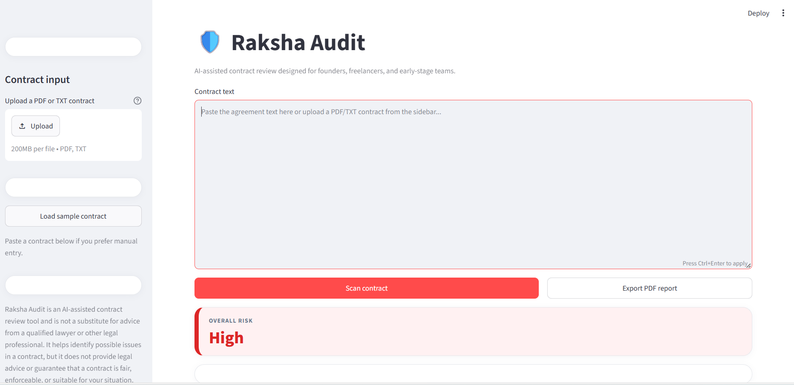
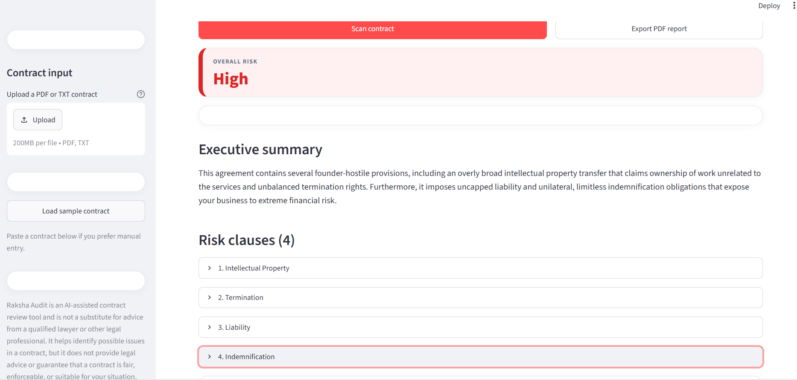
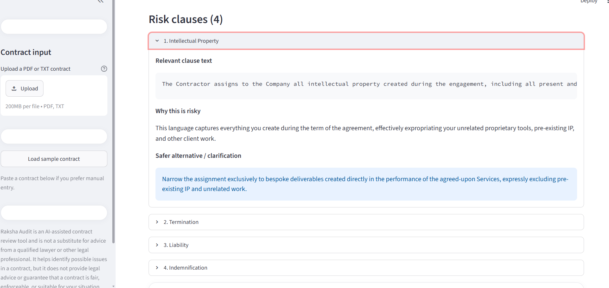
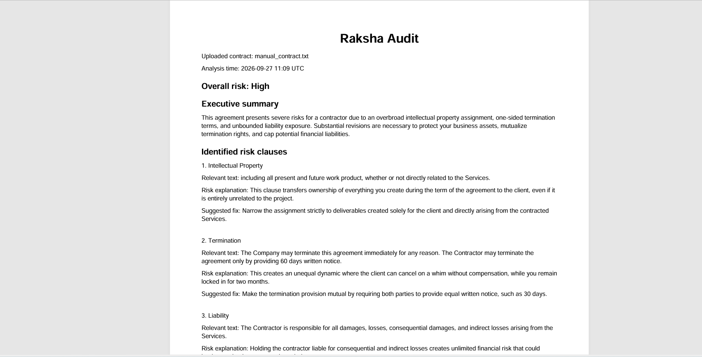

# Raksha Audit

**AI-powered contract risk analysis and audit assistant.**

Raksha Audit helps founders, freelancers, and small teams review contract language by surfacing potentially risky clauses and providing plain-language explanations and possible revisions.

## Problem

Manually reviewing a contract can make it difficult to quickly spot clauses that may create financial, intellectual-property, or operational risks. Important terms can be easy to overlook, especially when agreements are lengthy or written in unfamiliar legal language.

## Solution

Raksha Audit accepts pasted contract text or uploaded PDF/TXT files, extracts readable text when needed, and submits the contract for AI-assisted analysis using the Google Gemini API. It presents an overall risk assessment, identifies potential red-flag clauses, explains the associated concerns, suggests possible fixes, and can generate a PDF report for review or record keeping.

## Features

- Analyze contract text pasted into the application
- Upload PDF and TXT contracts
- AI-assisted contract risk analysis
- Overall risk assessment
- Red-flag clause identification
- Plain-language risk explanations
- Suggested fixes and safer alternatives
- PDF report generation
- Error handling for invalid or unreadable files and Gemini API errors or rate limits

## Technology Stack

- Python
- Streamlit
- Google Gemini API (`google-genai`)
- PyPDF (`pypdf`)
- ReportLab
- python-dotenv

## Application Workflow

**Contract Input → Text Extraction → Gemini Analysis → Risk Results → Suggested Fixes → PDF Report**

1. Paste contract text or upload a PDF/TXT file.
2. Review the extracted or entered text.
3. Select **Scan contract** to request AI-assisted analysis.
4. Review the risk assessment, summary, flagged clauses, explanations, and suggested fixes.
5. Export the results as a PDF report.

## Project Structure

| File | Purpose |
| --- | --- |
| `app.py` | Streamlit interface, contract text extraction, Gemini analysis, and PDF report generation. |
| `requirements.txt` | Python dependencies required to run the application. |
| `.env.example` | Example environment configuration containing a placeholder API key value. |
| `.gitignore` | Excludes local secrets, virtual environments, and generated Python files from Git. |
| `README.md` | Project overview, setup instructions, workflow, and documentation. |

## Setup

### 1. Clone the repository

```bash
git clone https://github.com/thatikondayamini1-spec/Raksha-Audit.git
cd Raksha-Audit
```

### 2. Create and activate a virtual environment

**Windows PowerShell:**

```powershell
python -m venv venv
.\venv\Scripts\Activate.ps1
```

**macOS/Linux:**

```bash
python3 -m venv venv
source venv/bin/activate
```

### 3. Install dependencies

```bash
python -m pip install -r requirements.txt
```

### 4. Configure the Gemini API key

Create a local `.env` file from the example:

**Windows PowerShell:**

```powershell
Copy-Item .env.example .env
```

**macOS/Linux:**

```bash
cp .env.example .env
```

Open `.env` and replace the placeholder with a Gemini API key:

```text
GEMINI_API_KEY=your_gemini_api_key_here
```

Keep the key private. The `.env` file is excluded from Git; do not commit API keys or other secrets.

### 5. Run the application

```bash
python -m streamlit run app.py
```

Streamlit will print a local URL to open in your browser.

## Screenshots

### 1. Main Application

The contract input screen for entering or uploading an agreement.



### 2. AI Contract Analysis

The analysis view with the overall contract risk assessment and executive summary.



### 3. Risk Clause Analysis

A flagged clause with its risk explanation and suggested alternative.



### 4. Generated PDF Report

Example of the generated contract review PDF report.



## Limitations

- Live analysis requires a valid Gemini API key.
- Gemini API availability, rate limits, and account quota can affect whether an analysis request completes.
- Results may be incomplete or inaccurate and should be reviewed by a qualified legal professional.

## Future Improvements

- Add automated tests for contract parsing and report generation.
- Improve support for scanned PDFs that require optical character recognition.
- Add configurable analysis preferences for different contract types.

These are potential future enhancements and are not presented as existing functionality.

## Disclaimer

Raksha Audit is an AI-assisted contract issue-spotting tool. It is not a substitute for professional legal advice, does not establish an attorney-client relationship, and does not guarantee that a contract is fair, enforceable, or suitable for a particular situation. Consult a qualified legal professional before making decisions about a contract.

## Author

**Yamini Thatikonda**

B.Tech CSE
